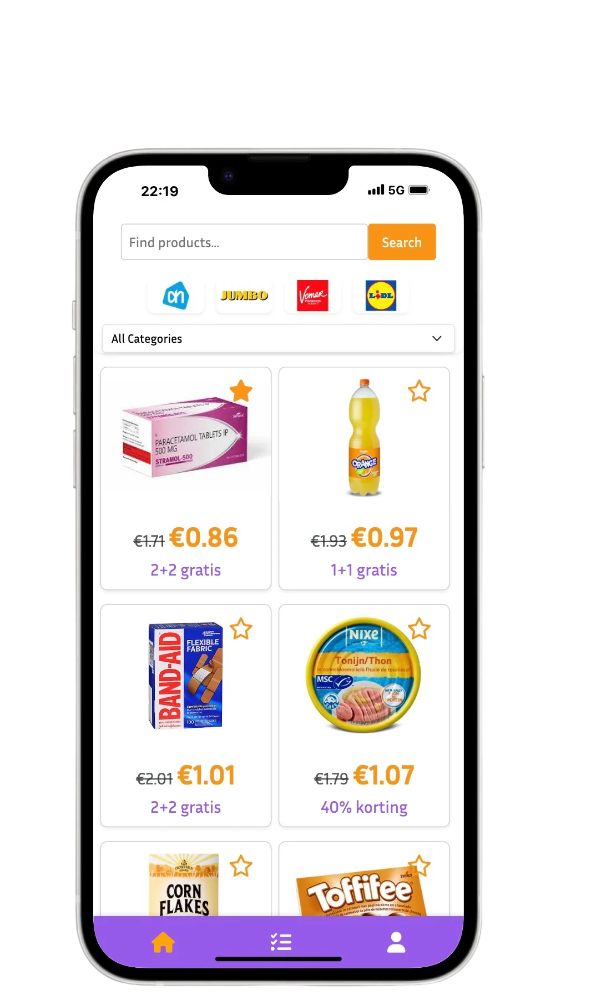
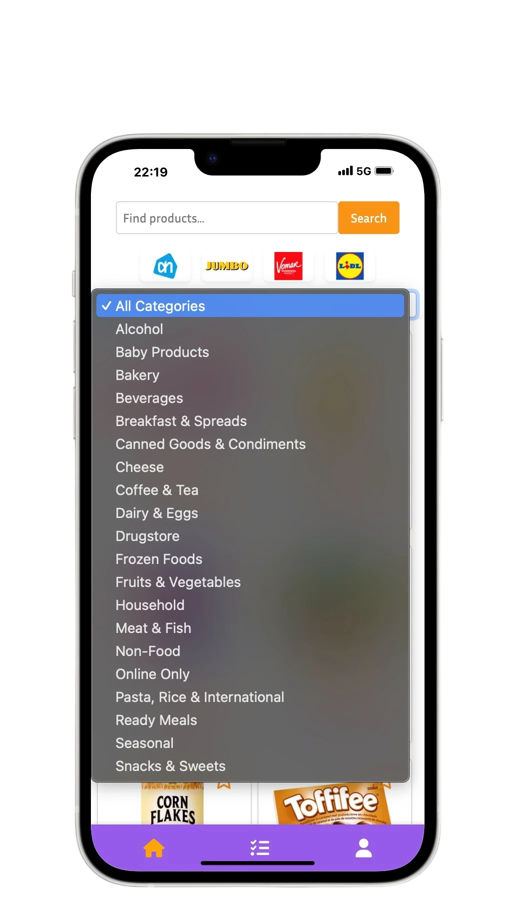
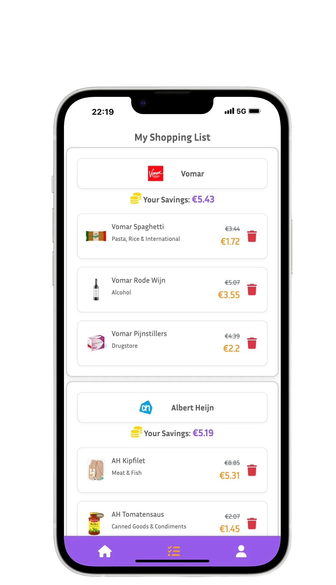

# DealHuntr

DealHuntr collects weekly deals from Dutch supermarkets in one place, so you can compare offers, save favourites and build a shopping list without opening every store's app.

Built in 2 weeks as the final project of the [Le Wagon Amsterdam](https://www.lewagon.com/amsterdam) Full Stack Web Development bootcamp (March 2025), by a team of three.

## Screenshots

<p align="center">
  
  
  
  
</p>

## Features

- **Automatic deal collection**: background jobs scrape the current deals from Albert Heijn and Jumbo on a schedule and store them as products and deals.
- **Search in English or Dutch**: search queries are translated to Dutch with the DeepL API, then matched with full-text search (pg_search).
- **Related deals**: each deal suggests similar offers, based on keyword matching on the product name and the deal category.
- **Favourites and shopping list**: signed-in users can save deals and build a shopping list they can update or clear.
- **Store pages and dashboard**: browse deals per store and see your saved items in one dashboard.

## Tech stack

- **Backend:** Ruby 3.3, Ruby on Rails 7.1, PostgreSQL
- **Frontend:** Hotwire (Turbo + Stimulus), Bootstrap 5, SCSS
- **Scraping:** Watir (for JavaScript-rendered pages), Nokogiri
- **Background jobs:** Solid Queue with recurring jobs, Mission Control for job monitoring
- **Other:** Devise (authentication), Pundit (authorization), DeepL API, Pagy, Docker

## My role

I focused on the user-facing side of the app:

- Built the home page and the search results view.
- Built the related deals section and the deal cards.
- Built the favourites, shopping list and dashboard pages.
- Wrote most of the styling (SCSS components and page layouts).
- Worked on the deals and pages controllers and the routes that connect these views.

## Run it locally

Requirements: Ruby 3.3.5, PostgreSQL, Chrome (for the Watir scraper).

```bash
git clone https://github.com/ozgekuzhan/dealhuntr.git
cd dealhuntr
bundle install
rails db:create db:migrate db:seed
rails server
```

To use search translation, add your DeepL credentials to a `.env` file:

```
DEEPL_AUTH_KEY=your_key
DEEPL_HOST=https://api-free.deepl.com
```

## Team

- [Ozge Kuzhan](https://github.com/ozgekuzhan)
- [paucotan](https://github.com/paucotan)
- Artem Zemskov
